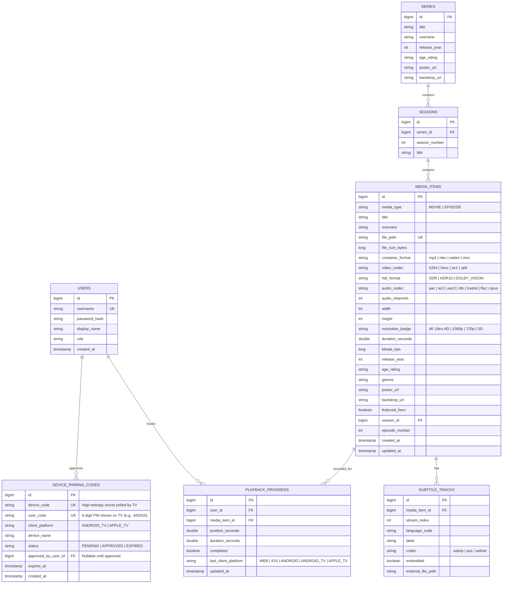

# Locaflix — Detailed Design Document (DDD / LLD)

## 1. Unified Monorepo Project Structure

```text
Locaflix/
├── package.json                             # Root workspace config (npm/pnpm workspaces)
├── AGENTS.md
├── ARCHITECTURE.md
├── HIGH_LEVEL_DESIGN.md
├── DETAILED_DESIGN.md
├── server/                                  # Spring Boot 4.1.x (Java 25 LTS)
│   ├── pom.xml
│   └── src/
│       ├── main/
│       │   ├── java/com/locaflix/server/
│       │   │   ├── LocaflixApplication.java
│       │   │   ├── config/                  # SecurityConfig, SqliteWalConfig, CorsPnaFilter
│       │   │   ├── controller/              # AuthController, DevicePairingController, HealthController,
│       │   │   │                            # LibraryController, MediaStreamController, HlsController,
│       │   │   │                            # SubtitleController, PlaybackController
│       │   │   ├── domain/                  # User, Series, Season, MediaItem, SubtitleTrack,
│       │   │   │                            # PlaybackProgress, DevicePairingCode, ClientPlatform
│       │   │   ├── dto/                     # Java 25 Records for REST APIs & FFprobe JSON models
│       │   │   ├── repository/              # Spring Data JPA Repositories
│       │   │   ├── security/                # JwtTokenProvider, StreamTokenService, JwtAuthenticationFilter
│       │   │   └── service/                 # StreamingDecisionService, FolderScannerService,
│       │   │                                # LibraryWatchService, FFprobeService, TranscodingService,
│       │   │                                # StoryboardService, CatalogService, PlaybackService,
│       │   │                                # DevicePairingService, MdnsService
│       │   └── resources/
│       │       └── application.yml
│       └── test/
│           └── java/com/locaflix/server/
│               ├── unit/                    # JUnit 5 + Mockito isolated unit tests
│               ├── component/               # @WebMvcTest and @DataJpaTest slice tests
│               └── integration/             # @SpringBootTest + SQLite WAL + HTTP 206 + FFmpeg tests
├── packages/
│   └── core-sdk/                            # Shared TypeScript SDK for Web, iOS, Android, Android TV, Apple TV
│       ├── package.json
│       ├── tsconfig.json
│       └── src/
│           ├── types/                       # api.ts, player.ts, capabilities.ts
│           ├── network/                     # connectionManager.ts (LAN/WAN probe + mDNS hook), apiClient.ts
│           ├── capabilities/                # clientProfiles.ts (WEB, IOS, ANDROID, ANDROID_TV, APPLE_TV)
│           ├── store/                       # authStore.ts, connectionStore.ts, playerStore.ts
│           ├── hooks/                       # useCatalog.ts, usePlaybackHeartbeat.ts, useDevicePairing.ts
│           ├── utils/                       # vttParser.ts, formatters.ts
│           └── __tests__/                   # Vitest unit & MSW integration tests for core-sdk
├── apps/
│   ├── web/                                 # React 19 + TypeScript + Vite + Tailwind CSS (Browsers)
│   │   ├── package.json
│   │   └── src/
│   │       ├── components/                  # Navbar, HeroBanner, MediaCarousel, VideoPlayerModal,
│   │       │                                # StoryboardScrubber, PairTvModal
│   │       └── __tests__/                   # Vitest + React Testing Library tests
│   ├── mobile/                              # React Native (iOS & Android Phones/Tablets)
│   │   ├── package.json
│   │   └── src/
│   │       ├── screens/                     # MobileHomeScreen, MobileDetailScreen, MobilePlayerScreen,
│   │       │                                # QrPairScannerScreen
│   │       ├── components/                  # TouchPlayerOverlay, PipController, ZeroconfDiscoveryBridge
│   │       └── __tests__/                   # Vitest + React Native Testing Library tests
│   └── tv/                                  # React Native TV (react-native-tvos: Android TV & Apple TV)
│       ├── package.json
│       └── src/
│           ├── screens/                     # TvPairingScreen (QR + 6-digit PIN), TvBrowseScreen,
│           │                                # TvDetailScreen, TvPlayerScreen
│           ├── components/                  # TvFocusRail, TvFocusableCard, TvRemoteHandler, TvSidebar
│           └── __tests__/                   # Vitest + RNTL 10-foot focus & pairing tests
└── e2e/                                     # End-to-End Test Suites
    ├── playwright.config.ts                 # Full-stack Web + Server E2E tests
    ├── web/                                 # auth.spec.ts, catalog.spec.ts, streaming.spec.ts, progress.spec.ts
    └── mobile-tv-maestro/                   # Maestro E2E flows for iOS, Android, Android TV, Apple TV
```

---

## 2. Database Schema & Persistence Layer (SQLite WAL)

### 2.1 Entity-Relationship Diagram



---

## 3. Backend Detailed Design (Java 25 LTS & Spring Boot 4.1.x)

### 3.1 Client Platform Profiles & 3-Tier `StreamingDecision` Engine

#### `ClientPlatform.java`
```java
package com.locaflix.server.domain;

public enum ClientPlatform {
    WEB,
    IOS,
    ANDROID,
    ANDROID_TV,
    APPLE_TV;

    public static ClientPlatform fromHeader(String headerValue) {
        if (headerValue == null || headerValue.isBlank()) {
            return WEB;
        }
        return switch (headerValue.trim().toUpperCase()) {
            case "IOS" -> IOS;
            case "ANDROID" -> ANDROID;
            case "ANDROID_TV" -> ANDROID_TV;
            case "APPLE_TV", "TVOS" -> APPLE_TV;
            default -> WEB;
        };
    }
}
```

#### Sealed 3-Tier `StreamingDecision.java`
```java
package com.locaflix.server.service;

public sealed interface StreamingDecision
        permits StreamingDecision.DirectPlay,
                StreamingDecision.DirectStreamRemux,
                StreamingDecision.HlsTranscode {

    /** Tier 1: 0% CPU — Spring ResourceRegion HTTP 206 byte-range streaming */
    record DirectPlay(String mimeType, long chunkSizeBytes) implements StreamingDecision {}

    /** Tier 2: <2% CPU — FFmpeg -c:v copy container remux into fMP4 HLS (e.g., MKV -> fMP4 on Apple TV / iOS) */
    record DirectStreamRemux(String reason, String targetAudioCodec, String segmentType) implements StreamingDecision {}

    /** Tier 3: Full GPU/CPU video + audio HLS transcode */
    record HlsTranscode(String reason, String targetVideoCodec, String targetAudioCodec, String hwAccelProfile)
            implements StreamingDecision {}
}
```

#### Multi-Platform Decision Logic (`StreamingDecisionService.java`)
```java
public StreamingDecision evaluate(MediaItem item, ClientPlatform platform, boolean isLan) {
    String container = item.getContainerFormat().toLowerCase();
    String vCodec = item.getVideoCodec().toLowerCase();
    String aCodec = item.getAudioCodec().toLowerCase();

    if (!isLan) {
        return new StreamingDecision.HlsTranscode("WAN adaptive bitrate required", "h264", "aac", detectHwAccel());
    }

    return switch (platform) {
        case ANDROID_TV -> {
            // ExoPlayer on Android TV natively demuxes MP4/MKV/WebM and decodes H264/HEVC/AV1/VP9 + passthrough audio
            if (List.of("mp4", "mkv", "webm").contains(container)
                    && List.of("h264", "hevc", "av1", "vp9").contains(vCodec)) {
                yield new StreamingDecision.DirectPlay(resolveMimeType(container), 4L * 1024 * 1024);
            }
            yield new StreamingDecision.HlsTranscode("Unsupported Android TV codec", "h264", "aac", detectHwAccel());
        }
        case ANDROID -> {
            // ExoPlayer on Android mobile supports MP4/MKV/WebM + H264/HEVC/AV1/VP9 + standard audio codecs
            if (List.of("mp4", "mkv", "webm").contains(container)
                    && List.of("h264", "hevc", "av1", "vp9").contains(vCodec)) {
                if (List.of("aac", "ac3", "eac3", "mp3", "opus", "flac").contains(aCodec)) {
                    yield new StreamingDecision.DirectPlay(resolveMimeType(container), 4L * 1024 * 1024);
                }
                yield new StreamingDecision.DirectStreamRemux("Remux audio to AAC for Android mobile", "aac", "fmp4");
            }
            yield new StreamingDecision.HlsTranscode("Unsupported Android video codec", "h264", "aac", detectHwAccel());
        }
        case IOS, APPLE_TV -> {
            // Apple AVPlayer natively plays MP4/MOV with H264/HEVC and AAC/AC3/EAC3
            boolean appleVideoOk = List.of("h264", "hevc").contains(vCodec);
            boolean appleAudioOk = List.of("aac", "ac3", "eac3", "mp3", "alac").contains(aCodec);
            if (List.of("mp4", "mov", "m4v").contains(container) && appleVideoOk && appleAudioOk) {
                yield new StreamingDecision.DirectPlay("video/mp4", 4L * 1024 * 1024);
            }
            if (appleVideoOk) {
                // MKV with HEVC/H264 -> Lossless video copy (-c:v copy) into fMP4 HLS!
                String targetAudio = appleAudioOk ? "copy" : "aac";
                yield new StreamingDecision.DirectStreamRemux(
                        "Remux MKV to fMP4 HLS for Apple AVPlayer without video re-encode", targetAudio, "fmp4");
            }
            yield new StreamingDecision.HlsTranscode("Video codec requires transcode for Apple device", "h264", "aac", detectHwAccel());
        }
        case WEB -> {
            boolean webContainerOk = List.of("mp4", "webm").contains(container);
            boolean webVideoOk = List.of("h264", "av1", "vp9").contains(vCodec);
            boolean webAudioOk = List.of("aac", "mp3", "opus", "flac").contains(aCodec);
            if (webContainerOk && webVideoOk && webAudioOk) {
                yield new StreamingDecision.DirectPlay("video/" + container, 4L * 1024 * 1024);
            }
            if ("h264".equals(vCodec)) {
                yield new StreamingDecision.DirectStreamRemux("Remux H.264 MKV for Web HLS", "aac", "mpegts");
            }
            yield new StreamingDecision.HlsTranscode("Browser requires H.264/AAC transcode", "h264", "aac", detectHwAccel());
        }
    };
}
```

### 3.2 FFmpeg Direct Stream Remux vs. Full Transcode Commands (`TranscodingService`)

Managed inside Java 25 `StructuredTaskScope`:

1. **Tier 2: Direct Stream Remux (`mode=remux` for iOS / Apple TV / Web)**:
   Copies the compressed video bitstream directly (`-c:v copy`) without decoding/encoding:
   ```bash
   ffmpeg -hide_banner -loglevel warning \
     -ss <startSeconds> -copyts -start_at_zero \
     -i <inputFilePath> \
     -map 0:v:0 -map 0:a:0 \
     -c:v copy \
     -c:a aac -b:a 192k -ac 2 \
     -f hls -hls_time 3 -hls_list_size 0 \
     -hls_segment_type fmp4 \
     -start_number <segmentIndex> \
     -hls_fmp4_init_filename "init.mp4" \
     -hls_segment_filename "<sessionDir>/segment_%05d.m4s" \
     "<sessionDir>/live.m3u8"
   ```
2. **Tier 3: Full Adaptive HLS Transcode (`mode=transcode`)**:
   Uses detected GPU hardware encoder (`h264_nvenc`, `h264_qsv`, `h264_amf`, `h264_videotoolbox`, or fallback `libx264 -preset veryfast`) with forced 3-second keyframe cadence (`-g 72 -keyint_min 72 -sc_threshold 0`).

### 3.3 TV 10-Foot Device Pairing Service (`DevicePairingService`)

- **`initiateDevicePairing(platform, deviceName)`**:
  - Generates a cryptographically random 32-byte `deviceCode` and a human-friendly 6-digit `userCode` (formatted `XXX-XXX`, excluding ambiguous characters).
  - Saves `DevicePairingCode` with status `PENDING` and a 5-minute TTL.
  - Returns `{ deviceCode, userCode, qrPayload: "locaflix://pair?code=" + userCode, expiresInSeconds: 300 }`.
- **`activateDeviceCode(authenticatedUserId, userCode)`**:
  - Looks up non-expired `PENDING` record matching `userCode`, sets `status = APPROVED` and `approvedByUserId = authenticatedUserId`.
- **`pollDeviceCode(deviceCode)`**:
  - If `PENDING`, returns HTTP `202 Accepted`.
  - If `APPROVED`, generates a long-lived TV JWT token, deletes the one-time pairing code, and returns `{ status: "APPROVED", accessToken, userProfile, localServerUrl, remoteServerUrl }`.

---

## 4. Shared Core SDK Detailed Design (`packages/core-sdk`)

### 4.1 Platform Capabilities & DTOs (`packages/core-sdk/src/types/api.ts`)

```typescript
export type ClientPlatform = 'WEB' | 'IOS' | 'ANDROID' | 'ANDROID_TV' | 'APPLE_TV';
export type ConnectionMode = 'LAN' | 'WAN' | 'PROBING';
export type StreamingMode = 'DIRECT_PLAY' | 'DIRECT_STREAM_REMUX' | 'HLS_TRANSCODE';

export interface MediaItem {
  id: number;
  mediaType: 'MOVIE' | 'EPISODE';
  title: string;
  overview: string;
  containerFormat: string;
  videoCodec: string;
  hdrFormat: 'SDR' | 'HDR10' | 'DOLBY_VISION';
  audioCodec: string;
  audioChannels: number;
  width: number;
  height: number;
  resolutionBadge: string;
  durationSeconds: number;
  releaseYear: number;
  ageRating: string;
  genres: string[];
  posterUrl: string;
  backdropUrl: string;
  streamingMode: StreamingMode;
  streamUrl: string;
  subtitles: SubtitleTrack[];
  resumePositionSeconds: number | null;
  lastClientPlatform: ClientPlatform | null;
  seriesId: number | null;
  seasonNumber: number | null;
  episodeNumber: number | null;
}

export interface DeviceCodeResponse {
  deviceCode: string;
  userCode: string;
  qrPayload: string;
  expiresInSeconds: number;
}
```

### 4.2 Hybrid mDNS + HTTP Probe Connection Manager (`packages/core-sdk/src/network/connectionManager.ts`)

```typescript
export interface MdnsDiscoveryAdapter {
  discoverLocalServer(timeoutMs: number): Promise<string | null>;
}

export interface ServerEndpointsConfig {
  localAddress?: string;    // e.g., "http://192.168.1.50:8080" (or auto-discovered via mDNS)
  remoteAddress: string;    // e.g., "https://stream.yourdomain.com"
  mdnsAdapter?: MdnsDiscoveryAdapter; // Provided on iOS, Android, Android TV, Apple TV
}

export async function resolveOptimalConnection(config: ServerEndpointsConfig): Promise<{
  activeBaseUrl: string;
  mode: 'LAN' | 'WAN';
}> {
  let candidateLanUrl = config.localAddress;

  // Step 1: On Mobile & TV, auto-discover LAN IP via mDNS/Bonjour if not cached
  if (!candidateLanUrl && config.mdnsAdapter) {
    candidateLanUrl = (await config.mdnsAdapter.discoverLocalServer(1000)) ?? undefined;
  }

  // Step 2: Probe LAN health endpoint with 1.2s timeout
  if (candidateLanUrl) {
    try {
      const controller = new AbortController();
      const timer = setTimeout(() => controller.abort(), 1200);
      const res = await fetch(`${candidateLanUrl}/api/v1/health`, {
        signal: controller.signal,
        mode: 'cors',
      });
      clearTimeout(timer);
      if (res.ok) {
        return { activeBaseUrl: candidateLanUrl, mode: 'LAN' };
      }
    } catch {
      // Fall through to WAN
    }
  }

  return { activeBaseUrl: config.remoteAddress, mode: 'WAN' };
}
```

---

## 5. Platform-Specific Client Designs (`apps/web`, `apps/mobile`, `apps/tv`)

### 5.1 Web Client (`apps/web` — React 19 + Vite + Tailwind CSS)
- **Browsing UX**: Responsive dark-mode layout with `HeroBanner`, horizontal `MediaCarousel` rows, hover-zoom `MediaCard`s, and a `PairTvModal` where users can enter a 6-digit TV code to sign in their Apple TV or Android TV.
- **Player Engine**: Uses native HTML5 `<video>` for `DIRECT_PLAY` (`HTTP 206`) and `hls.js` / `video.js` for `DIRECT_STREAM_REMUX` and `HLS_TRANSCODE`, with WebVTT hover storyboard thumbnails and keyboard shortcuts (`Space`, `J`, `L`, `F`, `M`).

### 5.2 Mobile Client (`apps/mobile` — React Native for iOS & Android)
- **Native Playback Engine**: Wraps `react-native-video`:
  - **iOS**: Uses Apple `AVPlayer` with native Picture-in-Picture (PiP), AirPlay 2 routing, and HDR10/Dolby Vision display support.
  - **Android**: Uses `Media3 / ExoPlayer` with direct `.mkv` byte-range streaming (`DIRECT_PLAY`) and gesture brightness/volume swipe controls.
- **Zero-Config Discovery & TV Pairing**:
  - Uses `ZeroconfDiscoveryBridge` (`_locaflix._tcp.local.`) to find the home server automatically on Wi-Fi.
  - Includes `QrPairScannerScreen` so pointing the phone camera at an Apple TV or Android TV logs the TV in immediately.

### 5.3 Living-Room TV Client (`apps/tv` — `react-native-tvos` for Android TV & Apple TV)
- **10-Foot Spatial Focus Architecture**:
  - Designed for viewing from 3 meters away (`5%` overscan safe margins, large typography, zero pointer reliance).
  - Uses `TVFocusGuideView` and `hasTVPreferredFocus` to manage deterministic Up/Down/Left/Right focus transitions between the collapsible left `TvSidebar`, `TvHeroSpotlight`, and horizontal `TvFocusRail` carousels.
  - Focusable cards animate with a smooth `1.08x` scale transform and high-contrast cinema glow border when focused by the Android TV D-pad or Apple TV Siri Remote.
- **Remote Media Key Handling (`useTVEventHandler`)**:
  - Maps hardware remote events (`playPause`, `select`, `left`, `right`, `up`, `down`, `menu`, `fastForward`, `rewind`) directly to player timeline scrubbing and subtitle/audio track selection overlays.
- **QR / PIN Pairing Screen (`TvPairingScreen`)**:
  - On first launch, requests `/api/v1/auth/device-code`, renders a high-contrast QR code alongside the 6-digit PIN (`842-910`), and polls `/api/v1/auth/device-poll` every 3 seconds until approved.

---

## 6. Comprehensive 4-Tier Testing Specification

### 6.1 Tier 1: Unit Tests
| Workspace | Test Suite | Key Assertions |
| :--- | :--- | :--- |
| **`server/`** | `StreamingDecisionServiceTest.java` | Asserts all 5 `ClientPlatform` values (`WEB`, `IOS`, `ANDROID`, `ANDROID_TV`, `APPLE_TV`): verifies Android TV Direct Plays `.mkv` HEVC; verifies Apple TV/iOS selects `DirectStreamRemux` (`-c:v copy` fMP4) for `.mkv` HEVC and `DirectPlay` for `.mp4` HEVC; verifies WAN forces `HlsTranscode`. |
| **`server/`** | `RangeCalculationTest.java`, `FFprobeParserTest.java`, `TokenAndDevicePairingUnitTest.java` | Verifies 4 MB `ResourceRegion` slicing, `ffprobe` HDR/codec parsing into Java 25 records, JWT/stream-token signing, and 6-digit PIN expiration logic. |
| **`packages/core-sdk`** | `connectionManager.test.ts`, `clientProfiles.test.ts`, `vttParser.test.ts` | Verifies mDNS discovery -> LAN health probe -> WAN fallback transitions; verifies WebVTT `#xywh` sprite coordinate parsing. |
| **`apps/web`, `mobile`, `tv`** | `formatters.test.ts`, `focusNavigation.test.ts` | Verifies runtime formatting, progress percentage thresholds ($\ge 92\%$ completed), and TV directional focus grid coordinate calculations. |

### 6.2 Tier 2: Component-Level Tests
| Workspace | Test Suite | Key Assertions |
| :--- | :--- | :--- |
| **`server/`** | `MediaStreamControllerSliceTest.java`, `DevicePairingControllerSliceTest.java` (`@WebMvcTest`) | Verifies `HTTP 206` headers (`Accept-Ranges: bytes`, `Content-Range`) and TV device-code generation/activation endpoints. |
| **`server/`** | `MediaRepositoryTest.java`, `DevicePairingRepositoryTest.java` (`@DataJpaTest`) | Verifies catalog queries, per-user "Continue Watching" ordering, and pairing code lookup. |
| **`apps/web`** | `CatalogComponents.test.tsx`, `VideoPlayerModal.test.tsx` (Vitest + RTL) | Verifies Hero banner, carousel cards, keyboard shortcuts, and TV pairing modal submission. |
| **`apps/mobile`** | `MobilePlayerScreen.test.tsx`, `QrPairScannerScreen.test.tsx` (Vitest + RNTL) | Verifies touch overlay auto-hide, PiP toggle, and QR code payload extraction (`locaflix://pair?code=...`). |
| **`apps/tv`** | `TvPairingScreen.test.tsx`, `TvFocusableCard.test.tsx` (Vitest + RNTL) | Verifies 6-digit PIN display, polling state transition to catalog, and D-pad/Siri Remote focus ring activation. |

### 6.3 Tier 3: Integration Tests
| Workspace | Test Suite | Key Assertions |
| :--- | :--- | :--- |
| **`server/`** | `SqliteWalConcurrencyIntegrationTest.java` (`@SpringBootTest`) | Simulates concurrent heartbeats from Web, iOS, Android, Android TV, and Apple TV alongside library folder scanning with zero `SQLITE_BUSY` errors. |
| **`server/`** | `DirectPlayAndHlsIntegrationTest.java` (`@SpringBootTest`) | Verifies end-to-end byte-range streaming (`HTTP 206`), `StructuredTaskScope` fMP4 remuxing (`mode=remux`), and HLS transcoding (`mode=transcode`). |
| **`server/`** | `TvDevicePairingIntegrationTest.java` (`@SpringBootTest`) | Verifies complete lifecycle: TV requests code -> Polls (`202`) -> Mobile user activates code -> TV polls (`200 OK` with JWT) -> Replay attempt rejected. |
| **`packages/core-sdk`** | `sdkCrossDeviceSync.integration.test.ts` (Vitest + MSW) | Verifies pausing playback on `APPLE_TV` updates `Continue Watching` resume position when queried by `IOS` or `WEB`. |

### 6.4 Tier 4: End-to-End (E2E) Tests (`e2e/`)
1. **Web + Server Full-Stack Suite (`e2e/web/*.spec.ts` — Playwright)**:
   - Login & JWT persistence, LAN/WAN badge verification, Direct Play (`HTTP 206`) & HLS playback, WebVTT subtitle switching, timeline storyboard scrubbing, cross-device progress resume, and approving a TV's 6-digit pairing code from the web dashboard.
2. **Mobile & TV E2E Flows (`e2e/mobile-tv-maestro/*.yaml` — Maestro)**:
   - `tv-pairing-and-playback.yaml`: Launches TV app on Android TV / Apple TV simulator, verifies 6-digit PIN screen, activates PIN, navigates catalog via D-pad remote events, and starts 4K Direct Play video playback.
   - `mobile-browse-and-resume.yaml`: Launches Mobile app on iOS / Android simulator, auto-discovers LAN server, resumes movie from the TV's last timestamp, and verifies playback controls.
