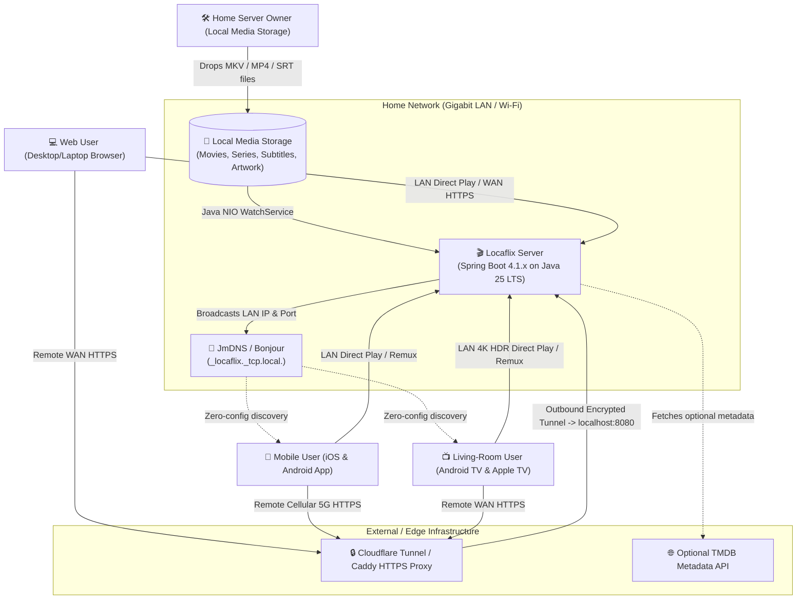
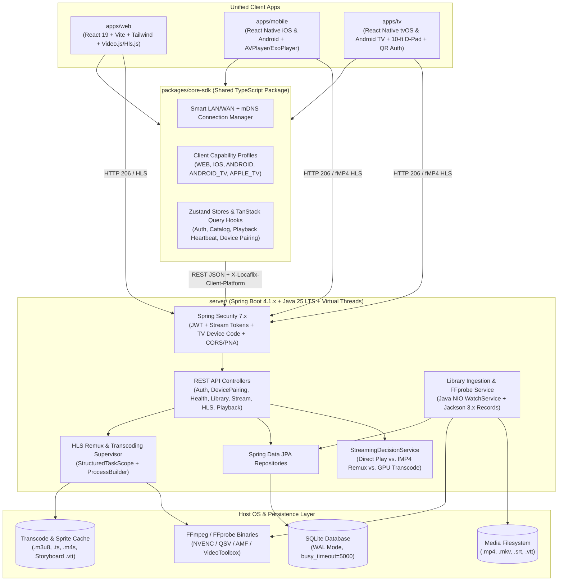
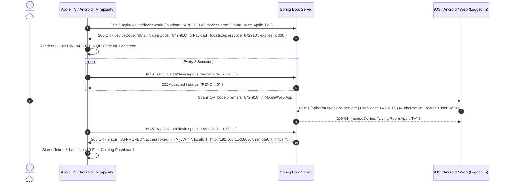
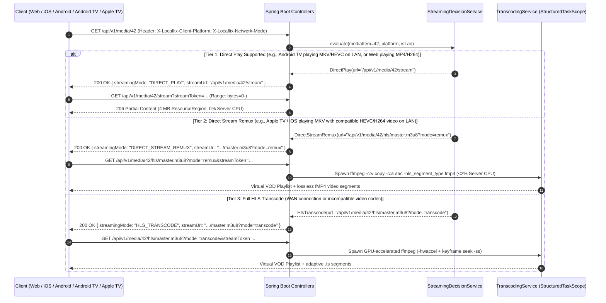
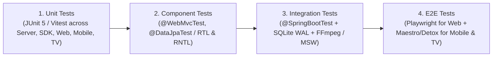

# Locaflix — High-Level Design (HLD)

## 1. Executive Summary & System Vision

**Locaflix** is a self-hosted personal media streaming ecosystem engineered to deliver a Netflix/Plex-caliber browsing and playback experience across **five client platforms**:
- **Web (`apps/web`)**: Desktop & mobile browsers (React 19 + Vite + Tailwind CSS + Video.js / Hls.js)
- **iOS (`apps/mobile`)**: iPhone & iPad (React Native + Apple `AVPlayer` + Picture-in-Picture)
- **Android (`apps/mobile`)**: Phones & Tablets (React Native + `Media3 / ExoPlayer`)
- **Android TV (`apps/tv`)**: Smart TVs, Shield TV, Chromecast with Google TV (`react-native-tvos` + `ExoPlayer` + 10-foot D-pad UI)
- **Apple TV (`apps/tv`)**: tvOS (`react-native-tvos` + `AVPlayer` + Siri Remote focus navigation)

All five clients share a unified TypeScript core package (**`packages/core-sdk`**) and communicate with a **Java 25 LTS / Spring Boot 4.1.x** backend over a **hybrid LAN/WAN networking topology**.

### 1.1 Core Design Principles
1. **3-Tier Client-Aware Playback (Direct Play -> Direct Stream Remux -> HLS Transcode)**:
   - **Tier 1 — Direct Play (`0%` CPU)**: Serve raw byte ranges (`HTTP 206 Partial Content`, 4 MB `ResourceRegion` chunks) whenever the target device (`WEB`, `IOS`, `ANDROID`, `ANDROID_TV`, `APPLE_TV`) can natively decode the container and codecs (e.g., Android TV `ExoPlayer` playing 4K HEVC MKV directly).
   - **Tier 2 — Direct Stream / Remux (`<2%` CPU)**: When a client (such as iOS or Apple TV `AVPlayer`) supports the video codec (`HEVC`/`H.264`) but not the `.mkv` container, remux on the fly (`ffmpeg -c:v copy`) into fragmented MP4 (`fMP4`) HLS without re-encoding video.
   - **Tier 3 — Adaptive HLS Transcoding (GPU Accelerated)**: Isolate full video/audio transcoding into managed `ffmpeg` subprocesses with `-ss` keyframe seeking when on WAN or when video codecs are unsupported.
2. **Structured Subprocess Isolation**: Supervise all `ffprobe` and `ffmpeg` worker processes using Java 25 Virtual Threads and `StructuredTaskScope` with non-blocking stdout/stderr reading and automatic 60s idle session cleanup.
3. **Zero-Config LAN Discovery & Zero-Trust WAN Access**: Broadcast `_locaflix._tcp.local.` via JmDNS so iOS, Android, Android TV, and Apple TV clients auto-discover the home server on Wi-Fi/Ethernet, and seamlessly fall back to an outbound-only Cloudflare Tunnel / Caddy HTTPS endpoint when away from home.
4. **Form-Factor Native UX**: Deliver a dark-mode cinematic experience tailored to each input paradigm—mouse/keyboard on Web, touch/gestures/PiP on Mobile, and **10-foot spatial D-pad / Siri Remote focus navigation with QR/6-digit PIN device pairing** on Android TV & Apple TV.
5. **Comprehensive 4-Tier Verification**: Enforce automated quality gates across Unit, Component-Level, Integration, and End-to-End (Playwright + Maestro/Detox) test suites.

---

## 2. System Context & Container Architecture

### 2.1 System Context Diagram (Level 1)

### 2.2 Monorepo Container & Subsystem Architecture (Level 2)

---

## 3. Core Subsystems & Responsibilities

| Subsystem | Primary Components | Key Responsibilities |
| :--- | :--- | :--- |
| **1. Library Ingestion & Metadata** | `FolderScannerService`, `LibraryWatchService`, `FFprobeService`, `ArtworkService` | Monitors media directories via Java NIO `WatchService`; parses Movie and `SxxExx` Episode filenames; extracts codecs, HDR/Dolby Vision profiles, audio channels, and subtitle streams via `ffprobe`; generates poster thumbnails and WebVTT storyboard sprites. |
| **2. Multi-Client Streaming Engine** | `StreamingDecisionService`, `MediaStreamController`, `HlsController`, `TranscodingService` | Matches media streams against `ClientPlatform` capabilities (`WEB`, `IOS`, `ANDROID`, `ANDROID_TV`, `APPLE_TV`); serves 4 MB `ResourceRegion` (`HTTP 206`) for Direct Play; performs `-c:v copy` fMP4 HLS remuxing for iOS/Apple TV MKVs; runs GPU-accelerated HLS transcoding with `-ss` keyframe seeking. |
| **3. Catalog & Cross-Device Progress** | `LibraryController`, `PlaybackController`, `CatalogService`, `PlaybackService` | Serves categorized sections (`Featured Hero`, `Continue Watching`, `Movies`, `TV Series`, genres); syncs 10-second playback heartbeats across Web, Mobile, and TV so a user can pause on Apple TV and resume at the exact second on iOS or Web. |
| **4. Security, TV Pairing & Networking** | `SecurityConfig`, `JwtTokenProvider`, `StreamTokenService`, `DevicePairingService`, `MdnsService` | Issues stateless JWTs and short-lived `?streamToken=` URLs; manages 6-digit PIN / QR code pairing for Android TV & Apple TV; broadcasts `_locaflix._tcp.local.` via JmDNS; enforces CORS and `Access-Control-Allow-Private-Network: true`. |
| **5. Shared Core SDK (`packages/core-sdk`)** | `connectionManager.ts`, `clientProfiles.ts`, `authStore.ts`, `useCatalog.ts`, `usePlaybackHeartbeat.ts` | Centralizes all TypeScript DTOs, mDNS + HTTP health probing, automatic LAN/WAN failover, token refresh, and playback progress syncing across all 5 client platforms. |
| **6. Platform Client Apps (`web`, `mobile`, `tv`)** | `apps/web`, `apps/mobile`, `apps/tv` | Implements form-factor-optimized UIs: keyboard/mouse & hover scrub thumbnails on Web; touch gestures, PiP, and QR scanner on iOS/Android; 10-foot D-pad/Siri Remote spatial focus navigation and QR login screen on Android TV/Apple TV. |

---

## 4. End-to-End Architectural Flows

### 4.1 TV 10-Foot QR / 6-Digit PIN Device Pairing Flow

### 4.2 Client-Aware 3-Tier Playback Decision Flow

---

## 5. Non-Functional Requirements & Technical Constraints

### 5.1 Concurrency & Resource Management
- **Java 25 Virtual Threads**: Enabled globally (`spring.threads.virtual.enabled=true`) so concurrent streams across living-room TVs, mobile devices, and web browsers scale effortlessly without blocking OS threads.
- **Structured Subprocess Lifecycle**: Every `ffmpeg` and `ffprobe` invocation is wrapped in a `StructuredTaskScope` that drains `stdout`/`stderr` non-blockingly and destroys orphaned processes after 60 seconds of inactivity.
- **SQLite WAL Serialization**: Configured with `journal_mode=WAL`, `synchronous=NORMAL`, and `busy_timeout=5000` to handle simultaneous playback heartbeats from multiple family devices alongside background library ingestion.

### 5.2 TV & Mobile Specific Quality Attributes
- **10-Foot TV Ergonomics**: All screens in `apps/tv` enforce a `5%` overscan-safe margin, minimum `24sp` typography, explicit directional focus guides (`TVFocusGuideView`), high-contrast focus scaling (`1.08x`), and hardware remote media key bindings.
- **Cross-Device Continuity**: Stopping playback on any device flushes an immediate heartbeat so opening another device within 1 second reflects the updated resume point in "Continue Watching".

---

## 6. 4-Tier Testing & Verification Strategy

1. **Unit Tests**: Validate per-platform `StreamingDecisionService` rules (`WEB`, `IOS`, `ANDROID`, `ANDROID_TV`, `APPLE_TV`), byte-range math, `FFprobe` JSON parsing, JWT/stream-token/device-code cryptography, and `core-sdk` LAN/WAN/mDNS resolution.
2. **Component-Level Tests**: Test Spring controllers (`@WebMvcTest`) and JPA repositories (`@DataJpaTest`); test Web components (`RTL`) and React Native Mobile/TV components (`@testing-library/react-native`), including TV D-pad focus transitions and PIN pairing UI.
3. **Integration Tests**: Full `@SpringBootTest` verification of SQLite WAL concurrency, `HTTP 206` byte-range streaming, `StructuredTaskScope` remux & transcode pipelines, TV device-code pairing workflow, and CORS/PNA security filters.
4. **End-to-End (E2E) Tests**: Playwright full-stack browser tests for Web + Server, paired with Maestro/Detox E2E flows for Mobile (iOS/Android) and TV (Android TV/Apple TV).
