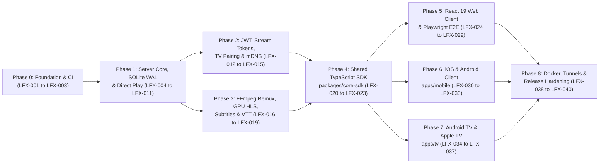

# Locaflix — Implementation Task Backlog & Git Tracking

This document breaks down the **Locaflix** architecture ([ARCHITECTURE.md](./ARCHITECTURE.md), [HIGH_LEVEL_DESIGN.md](./HIGH_LEVEL_DESIGN.md), [DETAILED_DESIGN.md](./DETAILED_DESIGN.md)) into **40 atomic, commit-sized engineering tasks (`LFX-001` – `LFX-040`)**.

---

## Git Commit & Tracking Protocol

1. **One Task = One Atomic Commit**: Each `LFX-XXX` task is implemented, tested across its required testing tiers, marked `[x]` in this file, and committed individually so the GitHub commit history provides 1:1 traceability.
2. **Commit Message Format**:
   ```text
   [LFX-XXX] <type>(<scope>): <short imperative summary>
   ```
   - **Allowed `<type>`**: `chore`, `feat`, `fix`, `test`, `docs`, `ci`, `perf`
   - **Allowed `<scope>`**: `repo`, `infra`, `server`, `core-sdk`, `web`, `mobile`, `tv`, `e2e`
   - **Example**: `[LFX-008] feat(server): implement 3-tier StreamingDecisionService across 5 client platforms`
3. **Status Legend**:
   - `[ ]` **TODO** — Not started
   - `[~]` **IN PROGRESS** — Currently being implemented
   - `[x]` **DONE** — Implemented, tests passing, committed with `[LFX-XXX]`

---

## Phase Dependency Graph



---

## Master Task Index

| Task ID | Status | Phase | Scope | Summary |
| :--- | :---: | :--- | :--- | :--- |
| **LFX-001** | `[x]` | Phase 0 | `repo` | Initialize Git monorepo, root Node workspaces, `.gitignore`, and baseline docs |
| **LFX-002** | `[ ]` | Phase 0 | `server` | Scaffold Spring Boot 4.1.x (Java 25 LTS) server, Virtual Threads & `/api/v1/health` |
| **LFX-003** | `[ ]` | Phase 0 | `infra` | Configure GitHub Actions CI workflows for Server, SDK, Clients, and E2E |
| **LFX-004** | `[ ]` | Phase 1 | `server` | Configure SQLite WAL mode & implement core JPA domain entities |
| **LFX-005** | `[ ]` | Phase 1 | `server` | Implement Spring Data JPA repositories & Virtual Thread WAL concurrency tests |
| **LFX-006** | `[ ]` | Phase 1 | `server` | Build filename metadata parser, `FolderScannerService` & `LibraryWatchService` |
| **LFX-007** | `[ ]` | Phase 1 | `server` | Implement `FFprobeService` using Java 25 Records & `StructuredTaskScope` |
| **LFX-008** | `[ ]` | Phase 1 | `server` | Implement 3-tier `StreamingDecisionService` for Web, iOS, Android, Android TV & Apple TV |
| **LFX-009** | `[ ]` | Phase 1 | `server` | Build `MediaStreamController` with 4 MB `ResourceRegion` HTTP 206 Direct Play |
| **LFX-010** | `[ ]` | Phase 1 | `server` | Build `CatalogService` & `LibraryController` (`/sections`, `/scan`, `/media/{id}`) |
| **LFX-011** | `[ ]` | Phase 1 | `server` | Build cross-device `PlaybackService` & `PlaybackController` (`/playback/progress`) |
| **LFX-012** | `[ ]` | Phase 2 | `server` | Implement Spring Security 7.x stateless JWT authentication & login rate limiting |
| **LFX-013** | `[ ]` | Phase 2 | `server` | Implement HMAC-signed `StreamTokenService` for native `<video>`, `AVPlayer` & `ExoPlayer` |
| **LFX-014** | `[ ]` | Phase 2 | `server` | Implement dual-origin CORS, Private Network Access (`PNA`) filter & JmDNS broadcaster |
| **LFX-015** | `[ ]` | Phase 2 | `server` | Implement TV 10-foot QR / 6-digit PIN `DevicePairingService` & endpoints |
| **LFX-016** | `[ ]` | Phase 3 | `server` | Build `TranscodingService` supervisor (`-c:v copy` fMP4 Remux, GPU HLS & `-ss` seek) |
| **LFX-017** | `[ ]` | Phase 3 | `server` | Build `HlsController` serving virtual VOD `.m3u8`, `init.mp4`, and `.ts`/`.m4s` segments |
| **LFX-018** | `[ ]` | Phase 3 | `server` | Implement `SubtitleService` & `SubtitleController` (SRT & embedded MKV -> WebVTT) |
| **LFX-019** | `[ ]` | Phase 3 | `server` | Implement `ArtworkService` & `StoryboardService` (posters, backdrops & VTT scrub sprites) |
| **LFX-020** | `[ ]` | Phase 4 | `core-sdk` | Scaffold `packages/core-sdk` with TypeScript DTOs & 5-platform capability profiles |
| **LFX-021** | `[ ]` | Phase 4 | `core-sdk` | Implement hybrid mDNS + HTTP probe `connectionManager.ts` & typed `LocaflixApiClient` |
| **LFX-022** | `[ ]` | Phase 4 | `core-sdk` | Implement shared Zustand stores & TanStack Query hooks (Catalog, Heartbeat, TV Pairing) |
| **LFX-023** | `[ ]` | Phase 4 | `core-sdk` | Implement WebVTT `#xywh` storyboard parser & timecode/badge formatters |
| **LFX-024** | `[ ]` | Phase 5 | `web` | Scaffold `apps/web` (React 19, Vite, Tailwind dark theme), `LoginView` & `Navbar` |
| **LFX-025** | `[ ]` | Phase 5 | `web` | Build `HeroBanner`, horizontal `MediaCarousel` rows & hover-zoom `MediaCard` |
| **LFX-026** | `[ ]` | Phase 5 | `web` | Build `MediaDetailModal` (stream specs, episodes) & `PairTvModal` (6-digit TV approval) |
| **LFX-027** | `[ ]` | Phase 5 | `web` | Build `VideoPlayerModal` (`<video>` Direct Play + `Hls.js`, keyboard shortcuts, quality) |
| **LFX-028** | `[ ]` | Phase 5 | `web` | Build `StoryboardScrubber` hover preview thumbnails & dynamic WebVTT subtitle switcher |
| **LFX-029** | `[ ]` | Phase 5 | `e2e` | Build Playwright full-stack E2E suite for Web + Server (`e2e/web`) |
| **LFX-030** | `[ ]` | Phase 6 | `mobile` | Scaffold `apps/mobile` (React Native iOS & Android), Bonjour/NSD mDNS bridge & Login |
| **LFX-031** | `[ ]` | Phase 6 | `mobile` | Build touch-optimized `MobileHomeScreen` & `MobileDetailScreen` |
| **LFX-032** | `[ ]` | Phase 6 | `mobile` | Build `MobilePlayerScreen` (`AVPlayer`/`ExoPlayer`, gestures, PiP, AirPlay & heartbeats) |
| **LFX-033** | `[ ]` | Phase 6 | `mobile` | Build `QrPairScannerScreen` for instant TV login & Mobile Maestro E2E flows |
| **LFX-034** | `[ ]` | Phase 7 | `tv` | Scaffold `apps/tv` (`react-native-tvos` Android TV & Apple TV) & `TvPairingScreen` |
| **LFX-035** | `[ ]` | Phase 7 | `tv` | Build 10-foot spatial focus navigation (`TvSidebar`, `TvFocusRail`, `TvFocusableCard`) |
| **LFX-036** | `[ ]` | Phase 7 | `tv` | Build `TvDetailScreen` & `TvPlayerScreen` (Siri/D-pad remote keys, 4K HDR Direct Play/Remux) |
| **LFX-037** | `[ ]` | Phase 7 | `e2e` | Implement cross-platform continuity integration & TV Maestro E2E verification |
| **LFX-038** | `[ ]` | Phase 8 | `infra` | Create Docker, Cloudflare Tunnel (`cloudflared`) & Caddy HTTPS deployment configs |
| **LFX-039** | `[ ]` | Phase 8 | `server` | Build Virtual Thread load benchmark & idle transcode session leak/reaper tests |
| **LFX-040** | `[ ]` | Phase 8 | `repo` | Export OpenAPI 3.1 contract, write comprehensive `README.md` & run final 4-tier audit |

---

## Detailed Task Specifications

### Phase 0: Repository, Monorepo Tooling & CI Foundation

#### `LFX-001` — Initialize Git Monorepo, Root Node Workspaces & Baseline Documentation
- **Status**: `[x]`
- **Scope**: `repo` | **Depends On**: None
- **Deliverables**:
  - Initialize Git repository (`git init -b master`), configure `.gitignore` (Java/Maven `target/`, SQLite `.db`/`-wal`/`-shm`, Scratch transcode output, Node `node_modules/`, Vite `dist/`, React Native/Expo, Playwright artifacts) and `.editorconfig`.
  - Create root `package.json` configuring workspaces (`packages/*`, `apps/*`, `e2e`) and shared TypeScript base config (`tsconfig.base.json`).
  - Commit foundational architecture and governance docs (`AGENTS.md`, `ARCHITECTURE.md`, `HIGH_LEVEL_DESIGN.md`, `DETAILED_DESIGN.md`, `TASKS.md`).
- **Verification**: Workspace package resolution check & clean `git status`.
- **Commit**: `[LFX-001] chore(repo): initialize git monorepo, workspaces, and design specifications`

#### `LFX-002` — Scaffold Spring Boot 4.1.x (Java 25 LTS) Server & Health Probe Endpoint
- **Status**: `[ ]`
- **Scope**: `server` | **Depends On**: `LFX-001`
- **Deliverables**:
  - Create `server/pom.xml` targeting Java 25 LTS and Spring Boot 4.1.x (`spring-boot-starter-web`, `spring-boot-starter-data-jpa`, `spring-boot-starter-security`, `spring-boot-starter-validation`, `sqlite-jdbc`, `hibernate-community-dialects`, `jjwt`, `jmdns`).
  - Enable Virtual Threads (`spring.threads.virtual.enabled=true`) in `application.yml` and configure `application-test.yml`.
  - Implement `LocaflixApplication.java`, RFC 9457 `GlobalExceptionHandler.java`, and sub-millisecond `HealthController` (`GET /api/v1/health`).
- **Required Tests**:
  - **Unit**: `HealthControllerUnitTest`
  - **Component**: `HealthControllerSliceTest` (`@WebMvcTest`)
  - **Integration**: `LocaflixApplicationTests` (`@SpringBootTest` verifying Virtual Thread executor active)
- **Commit**: `[LFX-002] feat(server): scaffold Spring Boot 4.1.x Java 25 server and health endpoint`

#### `LFX-003` — Configure GitHub Actions CI Pipeline for Monorepo Verification
- **Status**: `[ ]`
- **Scope**: `infra` | **Depends On**: `LFX-002`
- **Deliverables**:
  - Create `.github/workflows/ci.yml` with path-aware jobs for `server` (Temurin JDK 25 + FFmpeg + `mvn verify`), `clients` (Node 22 + typecheck + Vitest across `packages/core-sdk`, `apps/web`, `apps/mobile`, `apps/tv`), and `e2e` (Playwright full-stack test job).
  - Add commit message lint step verifying `[LFX-XXX]` prefix on PR commits.
- **Verification**: Validate workflow YAML syntax and run local Maven build check.
- **Commit**: `[LFX-003] ci(infra): configure GitHub Actions monorepo pipeline and task ID lint`

---

### Phase 1: Server Persistence, Ingestion & Direct Play Engine

#### `LFX-004` — Configure SQLite WAL Mode & Core JPA Domain Entities
- **Status**: `[ ]`
- **Scope**: `server` | **Depends On**: `LFX-002`
- **Deliverables**:
  - Implement `SqliteWalConfig` initializing `PRAGMA journal_mode=WAL; PRAGMA synchronous=NORMAL; PRAGMA busy_timeout=5000; PRAGMA foreign_keys=ON;`.
  - Implement `ClientPlatform` enum (`WEB`, `IOS`, `ANDROID`, `ANDROID_TV`, `APPLE_TV`), `MediaType` (`MOVIE`, `EPISODE`), `HdrFormat` (`SDR`, `HDR10`, `DOLBY_VISION`).
  - Create JPA entities: `User`, `Series`, `Season`, `MediaItem`, `SubtitleTrack`, `PlaybackProgress`, `DevicePairingCode`.
- **Required Tests**:
  - **Unit**: `ClientPlatformTest` & domain entity invariant tests
  - **Integration**: `SqliteWalConfigIntegrationTest` asserting `journal_mode` returns `wal`
- **Commit**: `[LFX-004] feat(server): configure SQLite WAL mode and implement core JPA entities`

#### `LFX-005` — Implement Spring Data JPA Repositories & Virtual Thread WAL Concurrency Tests
- **Status**: `[ ]`
- **Scope**: `server` | **Depends On**: `LFX-004`
- **Deliverables**:
  - Implement `UserRepository`, `SeriesRepository`, `SeasonRepository`, `MediaItemRepository`, `SubtitleTrackRepository`, `PlaybackProgressRepository`, `DevicePairingCodeRepository`.
  - Add custom JPQL queries for featured hero lookup, genre/title filtering, episode ordering, and per-user "Continue Watching" (`completed = false` ordered by `updatedAt DESC`).
- **Required Tests**:
  - **Component**: `MediaRepositoryTest` & `PlaybackProgressRepositoryTest` (`@DataJpaTest`)
  - **Integration**: `SqliteWalConcurrencyIntegrationTest` dispatching 50 concurrent Virtual Thread read/write tasks without `SQLITE_BUSY`
- **Commit**: `[LFX-005] feat(server): add JPA repositories and SQLite WAL virtual-thread concurrency tests`

#### `LFX-006` — Build Filename Metadata Parser, `FolderScannerService` & `LibraryWatchService`
- **Status**: `[ ]`
- **Scope**: `server` | **Depends On**: `LFX-005`
- **Deliverables**:
  - Implement `MediaFilenameParser` returning Java 25 `ParsedMediaFilename` records (distinguishing standalone movies `Title (2024)` from episodic TV `Show.Name.S01E02`).
  - Implement `FolderScannerService` using Java NIO `Files.walk` / `DirectoryStream` to index `.mp4`, `.mkv`, `.webm`, `.mov` files and match sidecar `.srt`/`.vtt` subtitles and `poster.jpg`/`backdrop.jpg`.
  - Implement `LibraryWatchService` monitoring media folders on a background Virtual Thread via `WatchService`.
- **Required Tests**:
  - **Unit**: `MediaFilenameParserTest` (movies, multi-episode patterns, 4K/1080p tags, edge cases)
  - **Integration**: `FolderScannerIntegrationTest` using JUnit `@TempDir` verifying automatic Movie & Series/Season/Episode hierarchy creation
- **Commit**: `[LFX-006] feat(server): implement filename parser, NIO folder scanner, and live WatchService`

#### `LFX-007` — Implement `FFprobeService` Using Java 25 Records & `StructuredTaskScope`
- **Status**: `[ ]`
- **Scope**: `server` | **Depends On**: `LFX-006`
- **Deliverables**:
  - Define immutable Jackson-mapped Java 25 records (`FFprobeOutput`, `FFprobeStream`, `FFprobeFormat`).
  - Implement `FFprobeService` running `ffprobe` via `ProcessBuilder` inside `StructuredTaskScope` with non-blocking virtual-thread `stdout`/`stderr` readers, 15s timeout protection, HDR10/Dolby Vision detection, resolution badge computation, and graceful fallback when `ffprobe` is absent in unit environments.
- **Required Tests**:
  - **Unit**: `FFprobeParserTest` (4K HEVC HDR10 TrueHD MKV, 1080p H.264 AAC MP4, embedded subtitles)
  - **Integration**: `FFprobeSubprocessIntegrationTest` testing process execution, non-blocking stream draining, and timeout cancellation
- **Commit**: `[LFX-007] feat(server): implement FFprobeService with Java 25 records and StructuredTaskScope`

#### `LFX-008` — Implement 3-Tier `StreamingDecisionService` Across All 5 Client Platforms
- **Status**: `[ ]`
- **Scope**: `server` | **Depends On**: `LFX-004`
- **Deliverables**:
  - Create `sealed interface StreamingDecision` (`DirectPlay`, `DirectStreamRemux`, `HlsTranscode`).
  - Implement `StreamingDecisionService` using Java 25 `switch` pattern matching over `ClientPlatform` (`WEB`, `IOS`, `ANDROID`, `ANDROID_TV`, `APPLE_TV`), container, video codec, audio codec, and LAN vs. WAN mode.
  - Implement `HardwareEncoderDetector` probing available FFmpeg encoders (`h264_nvenc`, `h264_qsv`, `h264_amf`, `h264_videotoolbox`, fallback `libx264`).
- **Required Tests**:
  - **Unit**: Exhaustive `@ParameterizedTest` `StreamingDecisionServiceTest` verifying Android TV Direct Plays MKV/HEVC, Apple TV/iOS selects `DirectStreamRemux` (`-c:v copy` fMP4) for MKV/HEVC and `DirectPlay` for MP4/HEVC, Web Direct Plays MP4/H.264, and WAN selects `HlsTranscode`.
- **Commit**: `[LFX-008] feat(server): implement 3-tier StreamingDecisionService across 5 client platforms`

#### `LFX-009` — Build `MediaStreamController` (`ResourceRegion` HTTP 206 Byte-Range Direct Play)
- **Status**: `[ ]`
- **Scope**: `server` | **Depends On**: `LFX-008`
- **Deliverables**:
  - Implement `ByteRangeService` & `MediaStreamController` (`GET /api/v1/media/{id}/stream`) returning `ResponseEntity<ResourceRegion>` with `206 Partial Content`, `Accept-Ranges: bytes`, accurate MIME detection (`video/mp4`, `video/x-matroska`, `video/webm`), and a configurable 4 MB (`4,194,304` bytes) chunk window.
- **Required Tests**:
  - **Unit**: `RangeCalculationTest` (missing `Range` header, `bytes=0-`, mid-file range, EOF tail range, invalid range `416 Requested Range Not Satisfiable`)
  - **Component**: `MediaStreamControllerSliceTest` (`@WebMvcTest`)
  - **Integration**: `DirectPlayStreamingIntegrationTest` streaming multi-megabyte test binary across sequential `Range` requests and verifying SHA-256 integrity
- **Commit**: `[LFX-009] feat(server): implement ResourceRegion HTTP 206 Direct Play streaming controller`

#### `LFX-010` — Build `CatalogService` & `LibraryController` (`/sections`, `/scan`, `/media/{id}`)
- **Status**: `[ ]`
- **Scope**: `server` | **Depends On**: `LFX-007`, `LFX-008`
- **Deliverables**:
  - Create Java 25 response records (`MediaItemDto`, `SubtitleTrackDto`, `CatalogRowDto`, `CatalogSectionsResponse`, `SeriesDetailDto`).
  - Implement `CatalogService` & `LibraryController` (`GET /api/v1/library/sections`, `POST /api/v1/library/scan`, `GET /api/v1/media/{id}`, `GET /api/v1/series/{id}`) dynamically computing `streamingMode` and `streamUrl` from request headers (`X-Locaflix-Client-Platform`, `X-Locaflix-Network-Mode`).
- **Required Tests**:
  - **Unit**: `CatalogServiceTest`
  - **Component**: `LibraryControllerSliceTest` (`@WebMvcTest`)
  - **Integration**: `CatalogIntegrationTest`
- **Commit**: `[LFX-010] feat(server): implement CatalogService and LibraryController REST endpoints`

#### `LFX-011` — Build Cross-Device `PlaybackService` & `PlaybackController`
- **Status**: `[ ]`
- **Scope**: `server` | **Depends On**: `LFX-010`
- **Deliverables**:
  - Implement `PlaybackService` & `PlaybackController` (`POST /api/v1/playback/progress`, `GET /api/v1/playback/continue-watching`).
  - Automatically mark items `completed = true` at $\ge 92\%$ progress, reset progress if restarted from $< 2\%$, record `lastClientPlatform`, and surface the next unwatched episode in "Continue Watching" when a TV episode finishes.
- **Required Tests**:
  - **Unit**: `PlaybackServiceTest` (92% completion threshold, next-episode promotion)
  - **Component**: `PlaybackControllerSliceTest` (`@WebMvcTest`)
  - **Integration**: `CrossDevicePlaybackIntegrationTest`
- **Commit**: `[LFX-011] feat(server): implement cross-device PlaybackService and progress heartbeat API`

---

### Phase 2: Security, Stream Tokens, TV Pairing & Local Discovery

#### `LFX-012` — Implement Spring Security 7.x Stateless JWT Auth & Rate Limiting
- **Status**: `[ ]`
- **Scope**: `server` | **Depends On**: `LFX-005`
- **Deliverables**:
  - Implement `JwtTokenProvider`, `JwtAuthenticationFilter`, `LoginRateLimitFilter` (sliding window per IP), `AuthService`, and `AuthController` (`POST /api/v1/auth/login`, `POST /api/v1/auth/refresh`, `GET /api/v1/auth/me`).
  - Configure `SecurityConfig` (stateless sessions, BCrypt password encoder, initial admin user seeder configurable via env vars).
- **Required Tests**:
  - **Unit**: `JwtTokenProviderTest`, `LoginRateLimitFilterTest`
  - **Component**: `AuthControllerSliceTest` (`@WebMvcTest`)
  - **Integration**: `AuthenticationIntegrationTest` (valid login, invalid credentials `401`, rate limit `429`, protected endpoint enforcement)
- **Commit**: `[LFX-012] feat(server): implement Spring Security 7.x JWT authentication and rate limiting`

#### `LFX-013` — Implement Short-Lived Signed `StreamTokenService` for Native Video Players
- **Status**: `[ ]`
- **Scope**: `server` | **Depends On**: `LFX-012`, `LFX-009`
- **Deliverables**:
  - Implement `StreamTokenService` issuing HMAC-SHA256 tokens bound to `(userId, mediaId, expiresAt)` via `POST /api/v1/auth/stream-token`.
  - Update security filter chain so `/stream`, `/hls/**`, `/subtitles/**`, `/artwork/**`, and `/storyboard.vtt` accept either `Authorization: Bearer <jwt>` or `?streamToken=<token>`.
- **Required Tests**:
  - **Unit**: `StreamTokenServiceTest` (valid signature, expired token, cross-mediaId replay rejection, tampered payload)
  - **Integration**: `StreamTokenAuthIntegrationTest` verifying HTTP 206 streaming with `?streamToken=` and `401` without credentials
- **Commit**: `[LFX-013] feat(server): add HMAC-signed stream tokens for native video and track elements`

#### `LFX-014` — Implement Dual-Origin CORS, Private Network Access (`PNA`) & JmDNS Broadcaster
- **Status**: `[ ]`
- **Scope**: `server` | **Depends On**: `LFX-012`
- **Deliverables**:
  - Implement `CorsPnaFilter` permitting configured localhost, RFC1918 LAN subnets (`192.168.*.*`, `10.*.*.*`, `172.16-31.*.*`), and remote WAN HTTPS origins, and injecting `Access-Control-Allow-Private-Network: true` on preflight `OPTIONS` requests.
  - Implement `MdnsService` using JmDNS to register `_locaflix._tcp.local.` on active LAN interfaces with clean startup/shutdown lifecycle hooks.
- **Required Tests**:
  - **Unit**: `MdnsServiceTest` (mocked JmDNS registration & graceful close)
  - **Integration**: `SecurityCorsPnaIntegrationTest` verifying CORS `Range` / `Content-Range` exposure and PNA preflight headers
- **Commit**: `[LFX-014] feat(server): add dual-origin CORS, Private Network Access filter, and JmDNS announcer`

#### `LFX-015` — Implement TV 10-Foot QR / 6-Digit PIN Device Pairing Flow
- **Status**: `[ ]`
- **Scope**: `server` | **Depends On**: `LFX-012`
- **Deliverables**:
  - Implement `DevicePairingService` & `DevicePairingController`:
    - `POST /api/v1/auth/device-code` (public, rate-limited; generates `deviceCode`, `XXX-XXX` `userCode`, and `locaflix://pair?code=...` `qrPayload`)
    - `POST /api/v1/auth/device-activate` (authenticated Web/Mobile user approves `userCode`)
    - `POST /api/v1/auth/device-poll` (TV polls with `deviceCode`; returns `202 PENDING` or `200 APPROVED` with JWT + LAN/WAN server URLs)
- **Required Tests**:
  - **Unit**: `DevicePairingServiceTest` (code format, 5-min expiry, single-use consumption)
  - **Component**: `DevicePairingControllerSliceTest` (`@WebMvcTest`)
  - **Integration**: `TvDevicePairingIntegrationTest` testing full TV -> Mobile approval -> TV JWT issuance lifecycle
- **Commit**: `[LFX-015] feat(server): implement TV 10-foot QR and 6-digit PIN device pairing endpoints`

---

### Phase 3: FFmpeg Direct Stream Remux, GPU HLS Transcoding, Subtitles & Storyboards

#### `LFX-016` — Build `TranscodingService` Supervisor (fMP4 Remux, GPU HLS & `-ss` Keyframe Seek)
- **Status**: `[ ]`
- **Scope**: `server` | **Depends On**: `LFX-008`
- **Deliverables**:
  - Implement virtual VOD playlist generator calculating exact 3-second segment entries from `durationSeconds`.
  - Implement `TranscodingService` managing active `TranscodeSession`s via Java 25 `StructuredTaskScope` + `ProcessBuilder`:
    - **Tier 2 (`mode=remux`)**: `-c:v copy -c:a aac -hls_segment_type fmp4` (`init.mp4` + `segment_%05d.m4s`)
    - **Tier 3 (`mode=transcode`)**: GPU/CPU H.264 + AAC (`segment_%05d.ts`) across quality profiles (`1080p`, `720p`, `480p`)
    - **Keyframe Seeking**: Cancels current scope and restarts FFmpeg with `-ss <segmentIndex * 3.0> -copyts -start_at_zero -start_number <segmentIndex>` when client jumps ahead/back.
    - **Idle Reaper**: Scheduled Virtual Thread terminating sessions idle $> 60\text{ s}$ and cleaning scratch files.
- **Required Tests**:
  - **Unit**: `VodPlaylistGeneratorTest`, `FFmpegCommandBuilderTest` (remux vs. NVENC/QSV/libx264 flags), `TranscodeSeekAndReaperTest`
  - **Integration**: `TranscodingSupervisorIntegrationTest` verifying subprocess lifecycle, seek restart, and scratch cleanup
- **Commit**: `[LFX-016] feat(server): implement StructuredTaskScope TranscodingService for fMP4 remux and HLS`

#### `LFX-017` — Build `HlsController` for Master Playlists, Init Fragments & Media Segments
- **Status**: `[ ]`
- **Scope**: `server` | **Depends On**: `LFX-016`, `LFX-013`
- **Deliverables**:
  - Implement `HlsController` (`GET /api/v1/media/{id}/hls/master.m3u8`, `GET /api/v1/media/{id}/hls/{quality}/index.m3u8`, `GET /api/v1/media/{id}/hls/{quality}/init.mp4`, `GET /api/v1/media/{id}/hls/{quality}/{segment}`) appending `streamToken` to playlist URIs so native Apple `AVPlayer` and `Hls.js` fetch segments seamlessly.
- **Required Tests**:
  - **Component**: `HlsControllerSliceTest` (`@WebMvcTest`)
  - **Integration**: `HlsStreamingIntegrationTest` verifying playlist generation, segment awaiting, and MIME types
- **Commit**: `[LFX-017] feat(server): implement HlsController for adaptive playlists and fMP4/TS segments`

#### `LFX-018` — Implement WebVTT Subtitle Extraction & Conversion Pipeline
- **Status**: `[ ]`
- **Scope**: `server` | **Depends On**: `LFX-007`, `LFX-013`
- **Deliverables**:
  - Implement pure-Java `.srt` -> `.vtt` converter (`SrtToWebVttConverter`) for external subtitle files and `StructuredTaskScope` `ffmpeg` extractor for embedded MKV/MP4 subtitle streams, cached on disk.
  - Implement `SubtitleController` (`GET /api/v1/media/{id}/subtitles/{trackIndex}`) returning `text/vtt; charset=UTF-8`.
- **Required Tests**:
  - **Unit**: `SrtToWebVttConverterTest` (timestamps `,` -> `.`, multi-line cues, UTF-8 BOM handling)
  - **Component**: `SubtitleControllerSliceTest` (`@WebMvcTest`)
  - **Integration**: `SubtitlePipelineIntegrationTest`
- **Commit**: `[LFX-018] feat(server): implement SRT and embedded subtitle extraction to WebVTT`

#### `LFX-019` — Implement Poster Artwork Extraction & Timeline Storyboard Sprite Generator
- **Status**: `[ ]`
- **Scope**: `server` | **Depends On**: `LFX-007`, `LFX-013`
- **Deliverables**:
  - Implement `ArtworkService` serving local sidecar posters/backdrops or extracting a representative video frame via `ffmpeg`, plus SVG fallback poster generation.
  - Implement `StoryboardService` generating sprite sheets (`storyboard.jpg`) and `storyboard.vtt` (`#xywh=x,y,w,h` cues every 10 seconds), exposed via `GET /api/v1/media/{id}/artwork/{type}`, `GET /api/v1/media/{id}/storyboard.vtt`, and `GET /api/v1/media/{id}/storyboard.jpg`.
- **Required Tests**:
  - **Unit**: `StoryboardVttGeneratorTest` (grid math & timestamp formatting)
  - **Component**: `ArtworkAndStoryboardControllerSliceTest` (`@WebMvcTest`)
  - **Integration**: `StoryboardIntegrationTest`
- **Commit**: `[LFX-019] feat(server): implement artwork frame extraction and WebVTT storyboard sprites`

---

### Phase 4: Shared TypeScript Core SDK (`packages/core-sdk`)

#### `LFX-020` — Scaffold `packages/core-sdk` with TypeScript DTOs & Client Capability Profiles
- **Status**: `[ ]`
- **Scope**: `core-sdk` | **Depends On**: `LFX-001`
- **Deliverables**:
  - Initialize `packages/core-sdk` (`@locaflix/core-sdk`) with TypeScript strict mode and Vitest.
  - Create explicit TypeScript interfaces matching all server Java 25 DTOs (`MediaItem`, `CatalogSectionsResponse`, `SubtitleTrack`, `PlaybackHeartbeatRequest`, `DeviceCodeResponse`, `StreamTokenResponse`, `PlayerState`).
  - Implement `clientProfiles.ts` describing codec/container capabilities and headers for `WEB`, `IOS`, `ANDROID`, `ANDROID_TV`, and `APPLE_TV`.
- **Required Tests**:
  - **Unit**: `clientProfiles.test.ts` verifying headers and Direct Play capability helpers per platform
- **Commit**: `[LFX-020] feat(core-sdk): scaffold shared TypeScript SDK, DTOs, and client capability profiles`

#### `LFX-021` — Implement Hybrid mDNS + HTTP Probe `connectionManager.ts` & Typed `LocaflixApiClient`
- **Status**: `[ ]`
- **Scope**: `core-sdk` | **Depends On**: `LFX-020`
- **Deliverables**:
  - Implement `resolveOptimalConnection` supporting optional `MdnsDiscoveryAdapter` (for iOS/Android/TV), 1200ms `AbortController` LAN `/api/v1/health` probe, automatic WAN HTTPS fallback, and background connectivity listener hooks.
  - Implement `LocaflixApiClient` wrapping `fetch` with automatic `Authorization: Bearer`, `X-Locaflix-Client-Platform`, `X-Locaflix-Network-Mode` headers, token refresh retry, and typed RFC 9457 `LocaflixApiError`.
- **Required Tests**:
  - **Unit**: `connectionManager.test.ts` (LAN success, 1.2s timeout abort -> WAN fallback, mDNS discovery -> LAN probe)
  - **Integration**: `apiClient.integration.test.ts` (Vitest + MSW testing auth headers, 401 refresh retry, and error handling)
- **Commit**: `[LFX-021] feat(core-sdk): implement LAN/WAN mDNS connection manager and typed API client`

#### `LFX-022` — Implement Shared Zustand Stores & TanStack Query Hooks in `core-sdk`
- **Status**: `[ ]`
- **Scope**: `core-sdk` | **Depends On**: `LFX-021`
- **Deliverables**:
  - Create platform-agnostic `StorageAdapter` + Zustand stores: `useAuthStore`, `useConnectionStore`, `usePlayerStore`.
  - Implement TanStack Query hooks: `useCatalogSections`, `useMediaDetail`, `useSeriesDetail`, `useStreamSession`, `usePlaybackHeartbeat` (10s periodic sync + immediate pause/close flush + catalog cache invalidation), and `useDevicePairing` (both TV polling hook and Mobile/Web activation mutation).
- **Required Tests**:
  - **Unit**: `stores.test.ts`
  - **Integration**: `sdkCrossDeviceSync.integration.test.ts` (MSW verifying heartbeat sync, Continue Watching invalidation, and TV pairing flow)
- **Commit**: `[LFX-022] feat(core-sdk): add Zustand stores and TanStack Query hooks for catalog, playback, and pairing`

#### `LFX-023` — Implement WebVTT Storyboard Parser & Shared Formatting Utilities
- **Status**: `[ ]`
- **Scope**: `core-sdk` | **Depends On**: `LFX-020`
- **Deliverables**:
  - Implement `vttParser.ts` parsing `storyboard.vtt` `#xywh=x,y,w,h` cues and binary-searching hover timestamps in $O(\log n)$.
  - Implement `formatters.ts` (duration `2h 14m`, scrub timecode `01:12:09`, progress percentage clamping, audio channel labels `5.1 Surround` / `7.1 Atmos` / `Stereo`).
- **Required Tests**:
  - **Unit**: `vttParser.test.ts`, `formatters.test.ts`
- **Commit**: `[LFX-023] feat(core-sdk): implement WebVTT storyboard parser and media display formatters`

---

### Phase 5: React 19 Web Client (`apps/web`) & Full-Stack Playwright E2E

#### `LFX-024` — Scaffold `apps/web` (React 19, Vite, Tailwind Dark Theme), `LoginView` & `Navbar`
- **Status**: `[ ]`
- **Scope**: `web` | **Depends On**: `LFX-022`
- **Deliverables**:
  - Scaffold `apps/web` with React 19, Vite, Tailwind CSS dark cinema palette (`#0a0a0f` obsidian surfaces, crimson/amber accents), Lucide icons, and `@locaflix/core-sdk`.
  - Build `LoginView.tsx` (credentials + collapsible LAN/WAN server endpoint configuration) and `Navbar.tsx` (debounced search bar, category tabs, live **"⚡ LAN Direct" / "🌐 WAN Tunnel"** status badge, "Pair TV" button, and user profile menu).
- **Required Tests**:
  - **Component**: `LoginView.test.tsx`, `Navbar.test.tsx` (Vitest + React Testing Library)
- **Commit**: `[LFX-024] feat(web): scaffold React 19 web client, dark theme, LoginView, and Navbar`

#### `LFX-025` — Build `HeroBanner`, Horizontal `MediaCarousel` Rows & Hover-Zoom `MediaCard`
- **Status**: `[ ]`
- **Scope**: `web` | **Depends On**: `LFX-024`, `LFX-023`
- **Deliverables**:
  - Build `HeroBanner.tsx` (cinematic backdrop vignette, resolution/HDR/audio badges, overview, Play/Resume from `XX:XX`, and More Info button).
  - Build `MediaCarousel.tsx` & `MediaCard.tsx` (smooth horizontal scroll rails, hover scale preview, Direct Play/HLS badge, and red/amber progress bar on "Continue Watching" cards).
- **Required Tests**:
  - **Component**: `CatalogComponents.test.tsx` (Vitest + RTL verifying badges, progress bars, and action callbacks)
- **Commit**: `[LFX-025] feat(web): build HeroBanner, MediaCarousel, and MediaCard catalog components`

#### `LFX-026` — Build `MediaDetailModal` & `PairTvModal` (6-Digit TV Activation UI)
- **Status**: `[ ]`
- **Scope**: `web` | **Depends On**: `LFX-025`
- **Deliverables**:
  - Build `MediaDetailModal.tsx` showing full codec/bitrate/HDR stream diagnostics, why `DIRECT_PLAY` / `DIRECT_STREAM_REMUX` / `HLS_TRANSCODE` was chosen, audio/subtitle tracks, and TV Series Season/Episode selector.
  - Build `PairTvModal.tsx` allowing the user to enter a 6-digit TV code (`XXX-XXX`) to authenticate an Apple TV or Android TV on their account.
- **Required Tests**:
  - **Component**: `MediaDetailModal.test.tsx`, `PairTvModal.test.tsx` (Vitest + RTL)
  - **Integration**: `webCatalogAndPairing.integration.test.tsx` (Vitest + MSW)
- **Commit**: `[LFX-026] feat(web): build MediaDetailModal and PairTvModal with RTL and MSW tests`

#### `LFX-027` — Build Custom `VideoPlayerModal` (Direct Play `<video>` + `Hls.js` Engine)
- **Status**: `[ ]`
- **Scope**: `web` | **Depends On**: `LFX-026`
- **Deliverables**:
  - Build `VideoPlayerModal.tsx` supporting native HTML5 `<video>` byte-range streaming for `DIRECT_PLAY` and `Hls.js` for `DIRECT_STREAM_REMUX` / `HLS_TRANSCODE` (with native HLS fallback on Safari).
  - Add auto-hiding cinema control bar, resume/start-over prompt, keyboard shortcuts (`Space`/`K`, `J`/`L` ±10s, `ArrowLeft`/`ArrowRight`, `F` fullscreen, `M` mute, `Escape` close), quality switcher (`Original (Direct Play)`, `Auto (HLS)`, `1080p`, `720p`, `480p`), and 10s heartbeat integration.
- **Required Tests**:
  - **Component**: `VideoPlayerModal.test.tsx` (engine selection, keyboard shortcuts, quality switching, unmount heartbeat flush)
- **Commit**: `[LFX-027] feat(web): build VideoPlayerModal with Direct Play, Hls.js, and keyboard controls`

#### `LFX-028` — Build `StoryboardScrubber` Hover Thumbnails & Dynamic WebVTT Subtitle Switcher
- **Status**: `[ ]`
- **Scope**: `web` | **Depends On**: `LFX-027`
- **Deliverables**:
  - Build `StoryboardScrubber.tsx` fetching `storyboard.vtt` and rendering floating sprite-cropped preview thumbnails + hover timestamp above the timeline scrub bar.
  - Add interactive subtitle popover menu toggling `<track kind="subtitles">` WebVTT streams on the fly.
- **Required Tests**:
  - **Component**: `StoryboardScrubber.test.tsx` & subtitle track selection tests (Vitest + RTL)
- **Commit**: `[LFX-028] feat(web): add WebVTT storyboard hover scrubber and dynamic subtitle selector`

#### `LFX-029` — Build Playwright Full-Stack E2E Suite for Web + Server (`e2e/web`)
- **Status**: `[ ]`
- **Scope**: `e2e` | **Depends On**: `LFX-019`, `LFX-028`
- **Deliverables**:
  - Configure `e2e/playwright.config.ts` with automated test fixture generation (generating valid lightweight H.264 MP4 and HEVC MKV sample videos + `.srt` files) and live Spring Boot + Vite server startup.
  - Implement Playwright specs:
    - `auth.spec.ts` (login, invalid login error, logout, protected routes)
    - `catalog-and-lan-wan.spec.ts` (LAN Direct vs. WAN Tunnel badge, search, detail modal)
    - `direct-play-and-hls.spec.ts` (verifies `HTTP 206` Direct Play on MP4, HLS `.m3u8` on MKV, subtitle toggle, storyboard scrub preview)
    - `playback-progress.spec.ts` (play -> seek -> close -> verify "Continue Watching" card & resume)
    - `tv-pairing-approval.spec.ts` (TV requests `/device-code`, Web user approves in `PairTvModal`, TV `/device-poll` receives JWT)
- **Required Tests**:
  - **E2E**: All 5 Playwright full-stack E2E test suites green
- **Commit**: `[LFX-029] test(e2e): implement full-stack Playwright E2E suite for Web and Spring Boot server`

---

### Phase 6: Mobile Client — iOS & Android (`apps/mobile`)

#### `LFX-030` — Scaffold `apps/mobile` (React Native iOS & Android), mDNS Bridge & Login
- **Status**: `[ ]`
- **Scope**: `mobile` | **Depends On**: `LFX-022`
- **Deliverables**:
  - Scaffold `apps/mobile` (React Native TypeScript) consuming `@locaflix/core-sdk`, mapping `Platform.OS === 'ios' ? 'IOS' : 'ANDROID'`.
  - Implement `ZeroconfDiscoveryBridge.ts` discovering `_locaflix._tcp.local.` (Bonjour on iOS, NSD on Android) and feeding `resolveOptimalConnection`.
  - Build `MobileLoginScreen.tsx` with auto-discovered local server pill and manual fallback input.
- **Required Tests**:
  - **Unit**: `ZeroconfDiscoveryBridge.test.ts`
  - **Component**: `MobileLoginScreen.test.tsx` (Vitest + React Native Testing Library)
- **Commit**: `[LFX-030] feat(mobile): scaffold React Native iOS/Android app, mDNS discovery, and login`

#### `LFX-031` — Build Touch-Optimized `MobileHomeScreen` & `MobileDetailScreen`
- **Status**: `[ ]`
- **Scope**: `mobile` | **Depends On**: `LFX-030`
- **Deliverables**:
  - Build `MobileHomeScreen.tsx` (featured hero card, pull-to-refresh, horizontal `FlatList` rails for "Continue Watching", Movies, and Series, LAN/WAN badge).
  - Build `MobileDetailScreen.tsx` (Direct Play / fMP4 Remux badge, technical specs, season/episode picker, instant Play/Resume button).
- **Required Tests**:
  - **Component**: `MobileHomeScreen.test.tsx`, `MobileDetailScreen.test.tsx` (RNTL)
- **Commit**: `[LFX-031] feat(mobile): build touch-optimized MobileHomeScreen and MobileDetailScreen`

#### `LFX-032` — Build `MobilePlayerScreen` (`AVPlayer` / `ExoPlayer`, Gestures & PiP)
- **Status**: `[ ]`
- **Scope**: `mobile` | **Depends On**: `LFX-031`
- **Deliverables**:
  - Build `MobilePlayerScreen.tsx` wrapping `react-native-video` configured for `AVPlayer` on iOS (Direct Play MP4 & fMP4 HLS Remux, Picture-in-Picture, AirPlay) and `Media3/ExoPlayer` on Android (Direct Play MKV/MP4 byte-range streaming).
  - Implement `TouchPlayerOverlay.tsx` (double-tap left/right ±10s seek, scrub slider, WebVTT subtitle bottom sheet, 10s playback heartbeat).
- **Required Tests**:
  - **Component**: `MobilePlayerScreen.test.tsx` (RNTL testing controls, double-tap seek, PiP toggle, and heartbeat flush)
  - **Integration**: `mobilePlaybackSync.integration.test.tsx` (MSW)
- **Commit**: `[LFX-032] feat(mobile): build MobilePlayerScreen with AVPlayer/ExoPlayer, gestures, and PiP`

#### `LFX-033` — Build `QrPairScannerScreen` for Instant TV Pairing & Mobile Maestro E2E Flows
- **Status**: `[ ]`
- **Scope**: `mobile`, `e2e` | **Depends On**: `LFX-032`
- **Deliverables**:
  - Build `QrPairScannerScreen.tsx` parsing `locaflix://pair?code=XXXXXX` QR codes (plus manual 6-digit PIN entry) and calling `device-activate` to log in an Apple TV or Android TV in one tap.
  - Author Maestro E2E flows in `e2e/mobile-tv-maestro/mobile-browse-and-resume.yaml` and `mobile-qr-pair-tv.yaml`.
- **Required Tests**:
  - **Unit**: `qrPayloadParser.test.ts`
  - **Component**: `QrPairScannerScreen.test.tsx` (RNTL)
  - **E2E**: Maestro flow validation
- **Commit**: `[LFX-033] feat(mobile): add QR TV pairing scanner and Mobile Maestro E2E test flows`

---

### Phase 7: Living-Room TV Client — Android TV & Apple TV (`apps/tv`)

#### `LFX-034` — Scaffold `apps/tv` (`react-native-tvos` Android TV & Apple TV) & `TvPairingScreen`
- **Status**: `[ ]`
- **Scope**: `tv` | **Depends On**: `LFX-022`
- **Deliverables**:
  - Scaffold `apps/tv` using `react-native-tvos` targeting both **Android TV** (`ANDROID_TV`) and **Apple TV / tvOS** (`APPLE_TV`) with `5%` overscan-safe margins and large 10-foot typography.
  - Build `TvPairingScreen.tsx` auto-discovering the LAN server via mDNS, calling `/api/v1/auth/device-code`, rendering a crisp QR code + 6-digit PIN (`842-910`), and polling `/api/v1/auth/device-poll` every 3s until approved.
- **Required Tests**:
  - **Component & Integration**: `TvPairingScreen.test.tsx` (RNTL + MSW verifying QR/PIN display, polling loop, expiration refresh, and transition to browse screen upon approval)
- **Commit**: `[LFX-034] feat(tv): scaffold react-native-tvos app and build QR/PIN TvPairingScreen`

#### `LFX-035` — Build 10-Foot Spatial Focus Navigation (`TvSidebar`, `TvFocusRail`, `TvFocusableCard`)
- **Status**: `[ ]`
- **Scope**: `tv` | **Depends On**: `LFX-034`
- **Deliverables**:
  - Implement spatial D-pad / Siri Remote focus engine (`focusNavigation.ts`) using `TVFocusGuideView` and `hasTVPreferredFocus`.
  - Build `TvSidebar.tsx` (Search, Home, Movies, Series, Settings), `TvHeroSpotlight.tsx` (auto-updating backdrop as user moves D-pad focus across cards), `TvFocusRail.tsx`, and `TvFocusableCard.tsx` (`1.08x` focus zoom + cinema glow border + progress bar).
- **Required Tests**:
  - **Unit**: `focusNavigation.test.ts` (directional clamping & rail memory)
  - **Component**: `TvFocusableCard.test.tsx`, `TvBrowseScreen.test.tsx` (RNTL simulating focus/blur events)
- **Commit**: `[LFX-035] feat(tv): implement 10-foot D-pad/Siri Remote spatial focus navigation and browse UI`

#### `LFX-036` — Build `TvDetailScreen` & `TvPlayerScreen` (Remote Media Keys & 4K HDR Direct Play/Remux)
- **Status**: `[ ]`
- **Scope**: `tv` | **Depends On**: `LFX-035`
- **Deliverables**:
  - Build `TvDetailScreen.tsx` (D-pad navigable Play/Resume buttons, season/episode rails, audio & subtitle track selector).
  - Build `TvPlayerScreen.tsx` & `TvRemoteHandler.ts` binding hardware remote events (`playPause`, `select`, `left`, `right`, `up`, `down`, `fastForward`, `rewind`, `menu`) to timeline scrubbing and track overlays, playing 4K HDR MKV/MP4 via Direct Play on Android TV (`ExoPlayer`) and Direct Play / fMP4 Remux on Apple TV (`AVPlayer`).
- **Required Tests**:
  - **Component**: `TvPlayerScreen.test.tsx` (RNTL testing remote event handling, scrub bar, subtitle selection, and heartbeat sync)
- **Commit**: `[LFX-036] feat(tv): build TvDetailScreen and TvPlayerScreen with hardware remote controls`

#### `LFX-037` — Cross-Platform Continuity Integration & TV Maestro E2E Verification
- **Status**: `[ ]`
- **Scope**: `e2e`, `core-sdk`, `server` | **Depends On**: `LFX-029`, `LFX-033`, `LFX-036`
- **Deliverables**:
  - Build automated multi-client continuity integration suite (`CrossPlatformContinuityIntegrationTest`) verifying:
    1. Pair `APPLE_TV` via 6-digit PIN from `IOS`
    2. Start 4K HEVC `.mkv` on `APPLE_TV` (asserting `DIRECT_STREAM_REMUX` fMP4) and pause at `25:00`
    3. Resume on `ANDROID_TV` / `ANDROID` (asserting `DIRECT_PLAY` `HTTP 206` from `25:00`) and pause at `50:00`
    4. Complete playback at `95%` on `WEB` and verify item leaves "Continue Watching" across all 5 platforms
  - Author TV Maestro E2E flow (`e2e/mobile-tv-maestro/tv-pairing-and-playback.yaml`).
- **Required Tests**:
  - **Integration & E2E**: Full multi-platform handoff test suite passing
- **Commit**: `[LFX-037] test(e2e): add 5-platform playback continuity tests and TV Maestro E2E suite`

---

### Phase 8: Production Deployment, Tunnel Templates & Release Hardening

#### `LFX-038` — Create Docker, Cloudflare Tunnel (`cloudflared`) & Caddy HTTPS Configs
- **Status**: `[ ]`
- **Scope**: `infra` | **Depends On**: `LFX-019`, `LFX-028`
- **Deliverables**:
  - Create multi-stage `Dockerfile` building `apps/web` and `server/` into a production Java 25 LTS + FFmpeg container image with optional GPU passthrough profiles.
  - Create `docker-compose.yml` + `infra/cloudflared/config.example.yml` (zero-open-port WAN tunnel) + `infra/caddy/Caddyfile` (automatic Let's Encrypt HTTPS + local TLS option).
- **Required Tests**:
  - **Integration**: Config validation test & container build/health-probe verification script
- **Commit**: `[LFX-038] feat(infra): add Docker, Cloudflare Tunnel, and Caddy HTTPS deployment configurations`

#### `LFX-039` — Virtual Thread Load Benchmarking & Transcode Reaper Hardening
- **Status**: `[ ]`
- **Scope**: `server` | **Depends On**: `LFX-017`
- **Deliverables**:
  - Implement `ServerLoadAndReaperStabilityTest` simulating simultaneous byte-range Direct Play streams, concurrent playback heartbeats across Virtual Threads, live folder indexing, and rapid HLS seek restarts, asserting zero `SQLITE_BUSY` errors, zero leaked FFmpeg processes, and deterministic scratch directory cleanup.
- **Required Tests**:
  - **Integration / Stress**: `ServerLoadAndReaperStabilityTest` passing under high concurrency
- **Commit**: `[LFX-039] test(server): add Virtual Thread load benchmark and FFmpeg process reaper stress tests`

#### `LFX-040` — OpenAPI 3.1 Contract Export, `README.md` & Final 4-Tier Release Audit
- **Status**: `[ ]`
- **Scope**: `repo` | **Depends On**: `LFX-037`, `LFX-038`, `LFX-039`
- **Deliverables**:
  - Configure Springdoc OpenAPI 3.1 spec generation (`docs/openapi.json`) documenting all endpoints and platform headers.
  - Write comprehensive root `README.md` covering architecture overview, local setup, media folder organization, LAN mDNS discovery, Cloudflare Tunnel WAN setup, and running Web, iOS, Android, Android TV, and Apple TV apps + all 4 test tiers.
  - Run full monorepo test verification (Unit + Component + Integration + E2E) and mark `LFX-040` complete.
- **Required Tests**:
  - **All 4 Tiers**: Full green build across `server`, `packages/core-sdk`, `apps/web`, `apps/mobile`, `apps/tv`, and `e2e`
- **Commit**: `[LFX-040] docs(repo): export OpenAPI 3.1 spec, add comprehensive README, and complete 4-tier audit`
